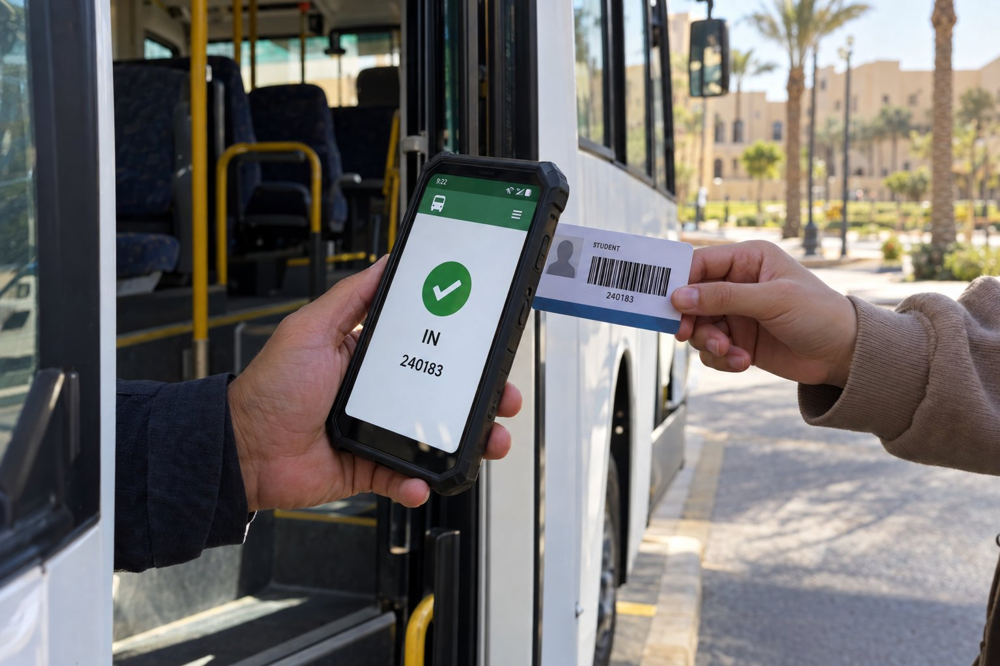
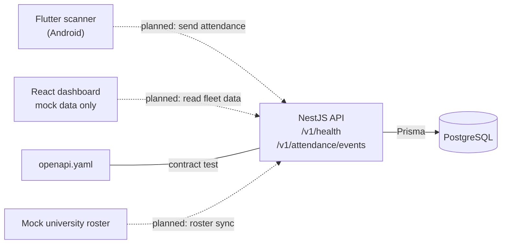
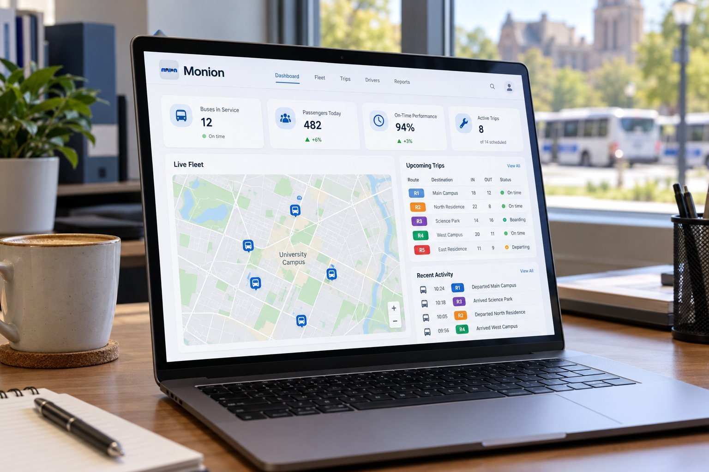

<div align="center">


# Monion

**Attendance for university buses: drivers scan student cards at the door, and the API keeps an immutable IN/OUT record per trip.**

[](https://github.com/VINEX-Tech/monion/actions/workflows/ci.yml)


[How it works](#how-it-works) · [Quick start](#quick-start) · [Status](#status) · [Roadmap](#roadmap) · [Security](#security-and-privacy)



<sub>Concept image of the planned product, not a photo or a screenshot.</sub>

</div>

## Why Monion

A university that runs buses needs to know which students got on which trip and when they got off.
Monion is a planned platform for that: drivers scan student cards at the door, the API keeps an
immutable IN/OUT attendance record per trip, and an operations dashboard shows the fleet. This
repository holds the first working slice of that plan and the data model for the rest.

## Highlights

- **Attendance as an ordered event record.** Each student's events on a trip must go IN, OUT, IN,
  OUT. IN after IN, OUT after OUT and OUT before any IN are rejected with `409`.
- **Safe to retry.** Every attendance request needs an `Idempotency-Key`. Sending the same key and
  body again returns the original event; reusing a key with a different body is a conflict.
- **Contract kept honest.** An OpenAPI 3.0 file covers exactly the two implemented endpoints, and a
  test fails if the API and the contract disagree.
- **Tested against a real database.** A Prisma schema (22 models) and an initial migration are
  applied and drift-checked against PostgreSQL 17 in CI.
- **Scanner prototype.** A Flutter barcode scanner with torch, zoom, camera switch and duplicate
  suppression. Scanned values stay in the phone's memory and are not uploaded.
- **One-command local stack.** Docker Compose brings up PostgreSQL, MinIO, Mailpit, a mock
  university roster and WireMock.

## How it works



Solid lines exist and are tested today. Dotted lines are the planned design in
[`docs/architecture.md`](docs/architecture.md) and are not built: the mobile app does not talk to
the API, and the dashboard is not connected to it.

## Pictures



<sub>Concept image of the planned dashboard, not a screenshot. The figures in the picture are made up for the image; the dashboard in this repository shows mock data only.</sub>

## Quick start

Requirements:

- Node.js 22 or newer (CI uses 24)
- Docker with Compose, for PostgreSQL and the local stack
- Flutter stable (CI pins 3.44.4) and the Android SDK, for the mobile app

```bash
git clone https://github.com/VINEX-Tech/monion.git && cd monion

cp .env.example .env            # then change the passwords
npm ci
docker compose -f infra/compose.yaml up -d postgres
npm run db:generate
npm run db:deploy               # applies apps/api/prisma/migrations
npm run dev                     # API on http://127.0.0.1:3000/v1
npm run dev:dashboard           # in a second terminal: dashboard on http://127.0.0.1:5173
```

Record an attendance event (the trip and student must exist and be active):

```bash
curl -X POST http://127.0.0.1:3000/v1/attendance/events \
  -H 'content-type: application/json' \
  -H "Idempotency-Key: $(uuidgen)" \
  -d '{"tripId":"<trip uuid>","studentId":"<student uuid>","direction":"IN",
       "occurredAt":"2026-10-01T07:30:00Z","source":"UNIVERSITY_QR","confidence":0.98}'
```

| Status | Meaning |
| --- | --- |
| 201 | Event stored |
| 200 | Same key and same body sent again; the original event is returned |
| 400 | Missing or invalid key, invalid body, or `MANUAL` without `manualReason` |
| 404 | Trip not active, or student not an active roster entry |
| 409 | IN after IN, OUT after OUT, OUT before any IN, key reused with a different body, or a concurrent update to retry |

The endpoint has **no authentication yet**. Do not expose it outside a local machine.

Mobile scanner on a USB-connected Android phone:

```bash
cd apps/mobile
flutter pub get
flutter run --profile
```

More detail is in [`docs/local-development.md`](docs/local-development.md).

## Status

**Prototype / MVP.** Not deployed. No users, no pilot, no field data.

| Area | Working now (tested in this repo) | Not built yet |
| --- | --- | --- |
| API | `GET /v1/health`; `POST /v1/attendance/events` with request validation, required `Idempotency-Key`, IN/OUT ordering rules, replay of a repeated key, and conflict on a reused key with a different body | Authentication, roles, audit records, trips, devices, GPS, alerts, roster sync, exports |
| Database | Prisma schema (22 models) and an initial migration, applied and drift-checked against PostgreSQL 17 in CI | Seed data, retention jobs, encryption of protected identifiers |
| Contract | OpenAPI 3.0 file covering exactly the two implemented endpoints; a test fails if the API and the contract disagree | Generated clients |
| Mobile (Flutter, Android) | Universal barcode scanner with torch, zoom and camera switch; duplicate suppression wired into the scan flow; values stay in memory and are not uploaded | Login, trips, sending attendance to the API, GPS, camera recording |
| Mobile domain logic | Frame pipeline (quality hints, QR then national ID then OCR fallback, roster check, backpressure) and device qualification rules, both unit tested with fakes | Connecting the frame pipeline to the camera (needs a frame-quality source and an offline roster) |
| Offline sync | Queue interface and an ordered drainer, unit tested with an in-memory store | A durable on-device store. **There is no working offline sync.** |
| Dashboard (React) | Layout preview. **Every figure on it is mock data** and the page says so | Any connection to the API |
| Local stack | Docker Compose: PostgreSQL, MinIO, Mailpit, mock university roster, WireMock | Production deployment |

Figures such as 95% scan accuracy, QR p95 of 900 ms and 1,000 labelled scans per device appear in
[`docs/device-qualification.md`](docs/device-qualification.md) and in `device_qualification.dart`.
They are **targets** for a future trial, not measured results.

### Known limitations

- No authentication or authorization on any endpoint.
- The Android release build is signed with the debug key so it installs on test phones. It is not
  fit for store distribution. A release keystore must be configured outside the repository before
  any real deployment.
- The mobile app does not talk to the API.
- Hardware named in `docs/` (the Samsung SM-A546E phone and the IMOU Ranger Pro camera) are
  candidate devices for a future trial. Neither has been qualified.
- `infra/nginx/monion.conf` is an example only; nothing is deployed.

## Roadmap

- [ ] Authentication, roles and audit records on the API
- [ ] Trips, devices, GPS, alerts, roster sync and exports
- [ ] Seed data, retention jobs and encryption of protected identifiers
- [ ] Generated API clients from the contract
- [ ] Mobile login and trips, sending attendance to the API, GPS and camera recording
- [ ] Frame pipeline connected to the camera, with a frame-quality source and an offline roster
- [ ] A durable on-device store for offline sync
- [ ] Dashboard connected to the API
- [ ] Release keystore for the Android app
- [ ] Device qualification trial for the candidate phone and camera
- [ ] Production deployment

## Tests

| Command | What it runs |
| --- | --- |
| `npm run lint` | ESLint over all TypeScript and JavaScript |
| `npm run typecheck` | `tsc` for the API and the dashboard |
| `npm test` | API unit, HTTP (in-memory database) and contract tests; dashboard tests; mock roster tests |
| `npm run contracts:check` | Validates `openapi.yaml` |
| `npm run build` | API, dashboard and mock roster builds |
| `bash scripts/test-postgres.sh` | Starts PostgreSQL in Docker, applies the migration, checks schema drift, runs the PostgreSQL HTTP suite |
| `cd apps/mobile && flutter analyze && flutter test` | Dart analysis and unit/widget tests |
| `bash scripts/verify.sh` | Everything above except the PostgreSQL suite |

CI ([`.github/workflows/ci.yml`](.github/workflows/ci.yml)) runs all of these plus a gitleaks scan.

## Repository layout

| Path | Stack | Contents |
| --- | --- | --- |
| `apps/api` | NestJS 11, Prisma 6, PostgreSQL | Health and attendance endpoints, schema, migration, unit, HTTP and PostgreSQL tests |
| `apps/dashboard` | React 19, Vite 7 | Dashboard layout with mock data |
| `apps/mobile` | Flutter, Android | Barcode scanner prototype and domain logic |
| `packages/contracts` | OpenAPI 3.0 | `openapi.yaml` |
| `infra` | Docker Compose | Local services, mock roster server, example reverse proxy config |
| `docs` | Markdown | Design notes and trial plans |

## Security and privacy

- Never commit `.env`, signing keys, camera credentials, exports, recordings, databases or
  readable identifiers.
- Barcode values stay in the phone's memory and are not sent anywhere.
- Fixtures and the mock roster use synthetic data only.
- Report a suspected vulnerability privately to the maintainers rather than in a public issue.

## License

MIT. See [LICENSE](LICENSE).

## Author

Designed and built by **Abdel Rahman Mohamad EL-Sayed** ([@AbdelRahman-Madboly](https://github.com/AbdelRahman-Madboly)) as a [VINEX](https://github.com/VINEX-Tech) product.
